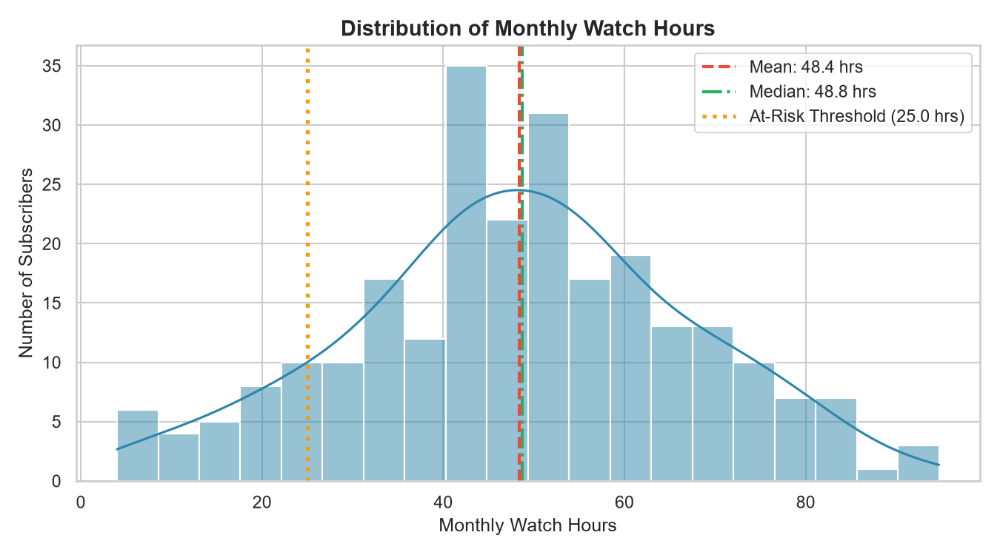
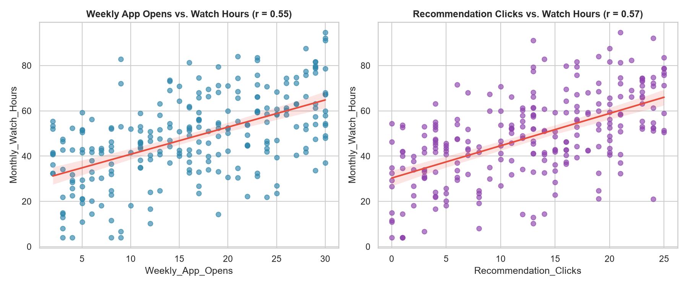
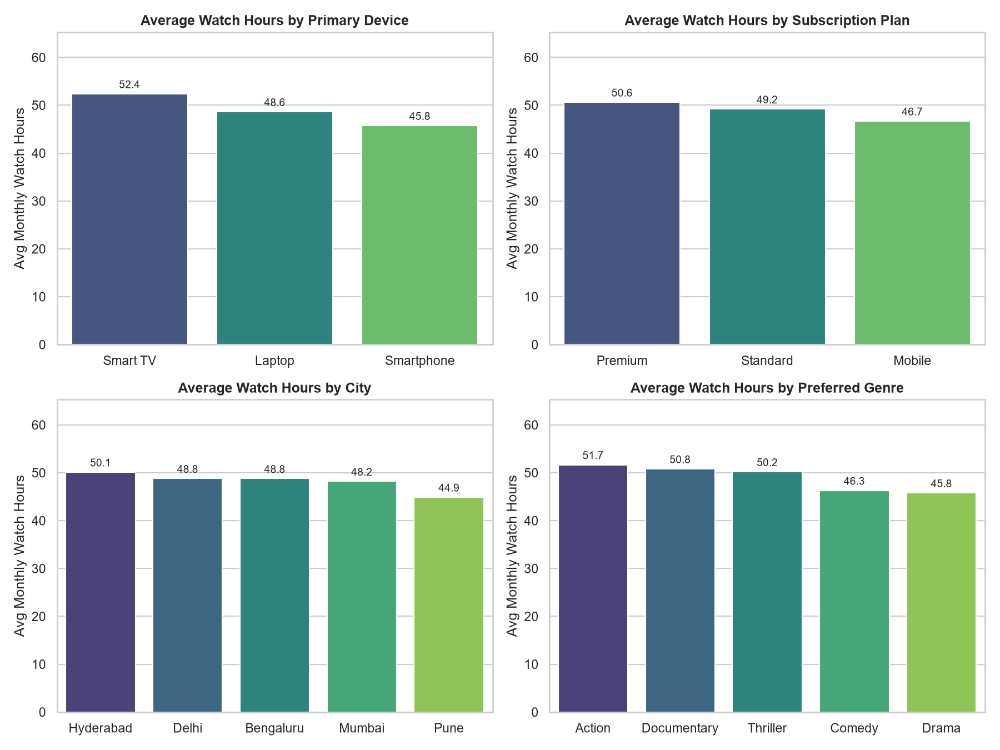
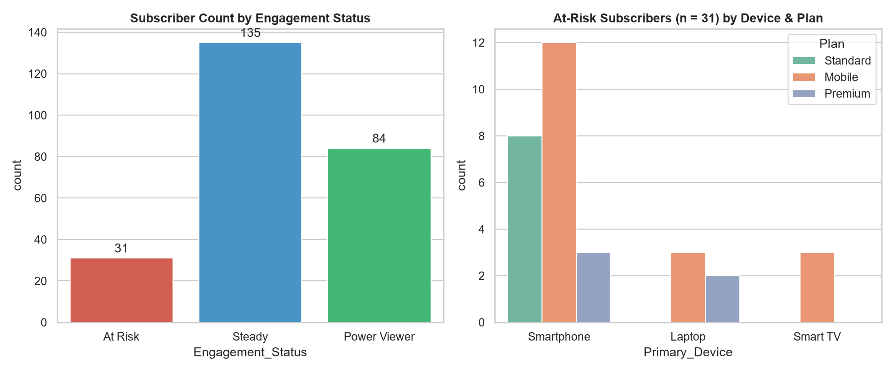

# OTT Viewer Engagement & Watch-Time Analysis

## Business Problem
The retention and product analytics team at an Indian OTT streaming platform wants to understand what drives subscribers to spend more time watching content each month. Subscribers with low monthly watch hours are far more likely to cancel their plans during the next billing cycle. By identifying which user behaviors, plans, and devices correlate with higher watch time, the team can improve its recommendation engine and run targeted re-engagement campaigns.

## Key Questions
1. **What does `Monthly_Watch_Hours` look like overall?** (Center, spread, range, and overall distribution.)
2. **Do `Weekly_App_Opens` and `Recommendation_Clicks` affect `Monthly_Watch_Hours`?** (Also check whether other numeric columns like `Viewer_Age` or `Monthly_Fee_INR` show any relationship.)
3. **Does `Monthly_Watch_Hours` differ by `City`, `Subscription_Plan`, `Preferred_Genre`, and `Primary_Device`?**
4. **Which records need attention?** Flag any subscriber with **`Monthly_Watch_Hours` below 25.0 hours** as **"At Risk"** of churning, and profile who these viewers are.

## Project Structure

    ott-viewer-engagement-analysis/
    ├── data/
    │   ├── raw/ott_viewing_data.csv
    │   └── processed/ott_viewing_data_clean.csv
    ├── notebooks/ott_analysis.ipynb
    ├── images/
    │   ├── chart1_watch_hours_distribution.png
    │   ├── chart2_numeric_relationships.png
    │   ├── chart3_category_comparison.png
    │   └── chart4_at_risk_viewers.png
    ├── requirements.txt
    └── README.md

## Data Dictionary

| Column Name | Data Type | Meaning | Valid Values or Valid Range |
| :--- | :--- | :--- | :--- |
| `Viewer_ID` | String | Unique identifier for each subscriber | `V1001` to `V1250` |
| `City` | String (Category) | Indian metro city where the subscriber is located | Mumbai, Delhi, Bengaluru, Hyderabad, Pune |
| `Subscription_Plan` | String (Category) | Active OTT membership tier | Mobile, Standard, Premium |
| `Preferred_Genre` | String (Category) | Most-watched content category by the viewer | Drama, Thriller, Comedy, Action, Documentary |
| `Primary_Device` | String (Category) | Main device used to stream content | Smartphone, Smart TV, Laptop |
| `Viewer_Age` | Integer | Age of the subscriber in years | 18 to 60 |
| `Monthly_Fee_INR` | Integer | Monthly subscription charge in Indian Rupees (including optional add-ons) | 149 to 749 |
| `Weekly_App_Opens` | Integer | Average number of times the subscriber opens the app per week | 2 to 30 |
| `Recommendation_Clicks` | Integer | Number of recommended titles clicked by the viewer in a month | 0 to 25 |
| `Last_Active_Date` | Date | Most recent date the subscriber streamed content | `YYYY-MM-DD` (2024-11-20 to 2026-11-19) |
| `Monthly_Watch_Hours` | Float (**Outcome**) | Total hours of content watched in the month | 4.0 to 95.0 |
| `Cost_Per_Watch_Hour_INR` | Float *(Engineered)* | Effective rupee cost per hour of content watched (`Monthly_Fee_INR / Monthly_Watch_Hours`) | Positive float |
| `Engagement_Status` | String *(Engineered)* | Viewer tier based on `Monthly_Watch_Hours` | `At Risk` (< 25.0), `Steady` (25.0–55.0), `Power Viewer` (> 55.0) |
| `Age_Group` | String *(Engineered)* | Age bracket binned from `Viewer_Age` | `18-25`, `26-35`, `36-45`, `46-60` |

## Steps Taken
1. **Load & Inspect:** Loaded `data/raw/ott_viewing_data.csv` (255 rows, 11 columns) and inspected data types, summary statistics, missing values, duplicates, and unique text categories.
2. **Data Cleaning:**
   * Removed **5 exact duplicate rows**, bringing the dataset to 250 unique subscribers.
   * Standardized inconsistent casing and extra whitespace in `City` (e.g., `"  Mumbai"`, `"DELHI"`, `" Bengaluru "`, `"mumbai"`).
   * Replaced **2 impossible `Viewer_Age` values** (`-7` and `172`) with `NaN`.
   * Imputed missing numeric values (`Viewer_Age`: 5 + 2 replaced, `Monthly_Fee_INR`: 6, `Recommendation_Clicks`: 5) using column medians and missing `Preferred_Genre` values (4) using the mode.
3. **Feature Engineering:** Created three new columns—`Cost_Per_Watch_Hour_INR`, `Engagement_Status`, and `Age_Group`.
4. **Analysis & Visualization:** Answered all four business questions using summary tables, correlation analysis, group aggregations, and four charts saved in `images/`.
5. **Export:** Saved the cleaned 250-row, 14-column dataset to `data/processed/ott_viewing_data_clean.csv`.

## Key Findings
* **Overall Watch Time:** Across the 250 subscribers, `Monthly_Watch_Hours` averages **48.37 hours** (median **48.75 hours**, standard deviation **18.74 hours**), ranging from **4.0 to 94.7 hours**. The middle 50% of subscribers watch between **37.02 and 59.98 hours** per month.
* **Key Numeric Drivers:** Both `Recommendation_Clicks` (**r = 0.57**) and `Weekly_App_Opens` (**r = 0.55**) show strong positive correlations with `Monthly_Watch_Hours`. In contrast, `Viewer_Age` (**r = -0.01**) and `Monthly_Fee_INR` (**r = 0.06**) have virtually no linear relationship with watch time.
* **Category Differences:**
  * **Device:** **Smart TV** viewers watch the most (**52.39 hrs/month**), followed by **Laptop** (**48.64 hrs**) and **Smartphone** (**45.76 hrs**).
  * **Plan:** **Premium** subscribers average **50.64 hrs/month**, compared to **49.20 hrs** for **Standard** and **46.71 hrs** for **Mobile**.
  * **City & Genre:** **Hyderabad** leads among cities (**50.14 hrs**) while **Pune** trails (**44.91 hrs**). Among genres, **Action** (**51.68 hrs**), **Documentary** (**50.81 hrs**), and **Thriller** (**50.21 hrs**) outpace **Comedy** (**46.33 hrs**) and **Drama** (**45.79 hrs**).
* **At-Risk Subscribers:** **31 subscribers (12.4%)** fall into the **"At Risk"** tier (< 25.0 hrs/month), alongside **135 Steady (54.0%)** and **84 Power Viewers (33.6%)**. At-Risk viewers average only **16.15 watch hours/month**, open the app nearly half as often (**9.06 vs. 17.33 opens/week**), click half as many recommendations (**6.81 vs. 13.48 clicks/month**), and pay **3.5x more per watch hour** (**₹29.51/hr vs. ₹8.39/hr**). Notably, **74.2% (23 of 31)** of At-Risk viewers stream primarily on **Smartphones**, and **58.1% (18 of 31)** are on the **Mobile** plan.

## Recommendations
1. **Re-engage Smartphone & Mobile-Plan Users Early:** Since 23 of the 31 At-Risk viewers use Smartphones (and 18 are on the Mobile plan), send automated push notifications and personalized weekend watchlists whenever a subscriber drops below 10 weekly app opens.
2. **Prioritize Recommendation Engine Improvements:** Because `Recommendation_Clicks` is the strongest driver of watch time (r = 0.57), surface shorter, high-hook trailers and "Continue Watching" prompts on the mobile home screen to lift clicks among low-engagement viewers.
3. **Encourage Big-Screen & Higher-Tier Adoption:** Smart TV users watch **6.6 hours more per month** than Smartphone users. Offer a free 14-day Smart TV casting or Standard-plan trial to engaged Mobile subscribers to boost long-term retention.
4. **Run Targeted Content Campaigns in Pune and Drama/Comedy Segments:** Launch curated mini-series and regional promotions aimed at Pune subscribers (lowest city average at 44.91 hrs) and Drama viewers (14 of the 31 At-Risk subscribers prefer Drama).

## Charts

